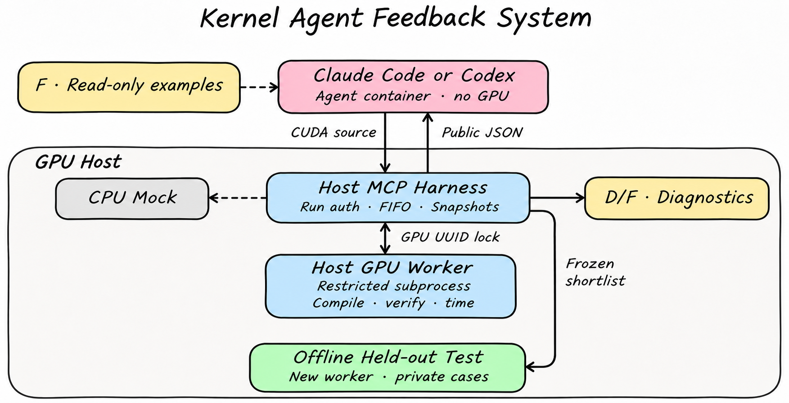

# Kernel Agent 评测反馈系统设计

首版在单张 NVIDIA GPU 上评测 FlashInfer-Bench 的 `rmsnorm_h4096`。每次 run 选用 Claude Code 或 Codex。Agent 修改 CUDA C++ 候选，宿主机负责评测、归档和独立验收。

## 系统架构



| 组件 | 职责 |
| --- | --- |
| [Run 启动器](../harness/__main__.py) | 创建工作区，保存 Agent、模型、后端、变体和预算。 |
| [Agent Runner](../runners/agent.py) | 在无 GPU 容器中启动 `claude -p` 或 `codex exec`。Agent 编辑 `rmsnorm.cu`，根据 MCP 反馈迭代。 |
| [Kernel Harness](../harness/evaluator.py) | 校验权限与配额，调度评测，管理快照、排名和验收。 |
| [GPU Worker](../harness/gpu_worker.py) | 每次评测启动独立进程，通过标准输入读取请求、标准输出返回结果 JSON。 |

Agent 容器挂载本次工作区，并访问模型服务和带鉴权的 MCP。宿主机 MCP 仅监听回环地址，Runner 为容器将 MCP URL 中的回环地址改为 `host.containers.internal`，并注入 run 的 Bearer 令牌。两种 Agent 共用 Streamable HTTP 和评测协议。 [MCP 服务](../harness/mcp_server.py) · [Codex 非交互模式](https://learn.chatgpt.com/docs/non-interactive-mode) · [Claude Code 非交互模式](https://code.claude.com/docs/en/headless)

## 宿主机 Worker 模式

| Run 选项 | 执行方式 |
| --- | --- |
| `--backend mock` | CPU Mock，复用 MCP 和评测 JSON，用于无卡联调。 |
| `--backend gpu --gpu-worker host` | 宿主机子进程直接访问指定 UUID 的 GPU。 |
| `--backend gpu --gpu-worker podman` | 通过 Podman CDI 透传 GPU，由 `--gpu-image` 指定镜像。默认和旧 run 均使用此模式。 |

Worker 模式写入 run 配置，`serve`、`evaluate` 和 `accept` 都按该配置调度。同一宿主机账户下，公开评测、诊断和验收共用按 GPU UUID 建立的设备锁。 [Worker 启动器](../harness/worker.py)

宿主机模式用 Bubblewrap 启动 `python -m harness.gpu_worker`。Worker 在独立用户、PID 和网络命名空间内运行，使用映射到普通 Harness 账户的 UID/GID 65534、只读运行时、独立临时目录和环境变量白名单。启动器仅挂载所选 GPU 及必要驱动设备，并将卡映射为 `cuda:0`。私有用例清单与完整记录由宿主机管理。 [宿主机启动器](../harness/host_worker.py)

## 提交候选与返回反馈

`evaluate_kernel(run_id, source)` 接收完整的 UTF-8 CUDA 源码，上限 128 KiB。Harness 先按源码哈希归档不可变快照，再将快照与本次用例送入 Worker。 [快照存储](../harness/results.py)

GPU 和 CPU Mock 在同一次调用中返回公开 JSON，包含 `candidate_id`、`backend`、`status`、逐用例结果或失败摘要。正确且完成 GPU 实测的候选才获得分数，反馈可带上 `best_candidate_id`。完整记录保存在 `results/`。 [公开反馈字段](../harness/feedback.py)

### 四阶段 GPU 评测

`rmsnorm_h4096` 使用 BF16 输入和输出，参考实现按 FP32 计算，`hidden_size=4096`，`eps=1e-5`。候选入口为 `rmsnorm.cu::run`，公开用例覆盖多种 batch 大小。 [任务定义](../tasks/rmsnorm.py)

1. **静态检查**校验源码、入口和依赖规则，拒绝调用现成算子。
2. **隔离编译**运行 `nvcc`，检查编译产物的符号，保存编译日志和 `ptxas` 的寄存器、spill、静态 shared memory 数据。
3. **正确性验证**检查形状、dtype 和数值容差，返回失败用例及误差摘要。
4. **性能测量**统一候选与基线的预分配、预热和缓存策略。计时前冲刷 L2，用 CUDA Event 采样并记录中位数和波动。公开排名按相对 PyTorch eager 加速比的几何平均值计算。

失败返回对应状态，例如 `rejected`、`compile_error`、`runtime_error` 或 `wrong_answer`。候选执行超时记为 `timeout`。`--worker-timeout` 从 Worker 启动起算，启动失败、失联或外层超时无结果时记为 `infrastructure_error` 并释放评测额度。超时后先回收任务和子进程，再检查设备健康。

## B/D/F 实验变体

| 变体 | Agent 可用资源 |
| --- | --- |
| B | `evaluate_kernel` 提供编译、正确性和测速反馈。 |
| D | B 加 `sanitize_kernel` 和 `profile_kernel`，对归档候选返回 Compute Sanitizer 与 Nsight Compute 摘要。 |
| F | D 加只读跨算子 CUDA 示例，人工筛选时排除目标算子实现。 |

Harness 按 run 授权，基础评测独立测量正式延迟。B/D/F 对照固定 Agent、模型、任务、起点和预算，分别记录模型用量、GPU 评测耗时和诊断耗时。

## 独立验收

搜索结束后，Harness 按公开排名冻结入围快照，依次启动新 Worker 在固定的私有用例上复测。交付首个通过全部用例、且相对 PyTorch eager 的加速比计入测量波动后仍超过门槛的候选，否则回退到 eager。留出结果只写入验收记录，包括候选、eager 和使用相同 `eps` 的 `flashinfer.norm.rmsnorm` 逐用例延迟。 [FlashInfer RMSNorm API](https://docs.flashinfer.ai/api/norm.html)

## 拟定代码结构

```text
kernel-agent/
├── tasks/
│   └── rmsnorm.py           # 算子接口、PyTorch 参考实现和用例
├── harness/
│   ├── __main__.py           # 初始化 run、服务启动与 Worker 选择
│   ├── evaluator.py         # 规则检查、配额、Worker 调度与验收
│   ├── worker.py            # Worker 调度、设备锁和故障恢复
│   ├── host_worker.py       # 宿主机隔离启动、CUDA 环境和设备挂载
│   ├── gpu_worker.py        # 隔离编译、正确性检查与测速
│   ├── mock_worker.py       # CPU 模拟后端
│   ├── diagnostics.py       # sanitizer 与 ncu 摘要
│   ├── results.py           # 候选快照、请求状态与评测历史
│   ├── feedback.py          # 精简诊断与性能反馈
│   └── mcp_server.py        # MCP 鉴权、接单与反馈
├── runners/                 # Agent 启动、MCP 客户端配置与日志
├── examples/                # F 的跨算子 CUDA 示例
└── results/                 # 每个 run 的源码快照、评测结果和最终交付
```

## 启动与验证

使用 `python -m harness run` 一键启动。依赖、镜像构建和 GPU smoke 命令见 [README](../README.md#run-an-agent-on-a-gpu)。

分开联调时，先在宿主机创建 run，再将输出中的 `run_id` 设为 `RUN_ID` 后启动服务。

```bash
python -m harness init --agent codex --model "$MODEL" --backend gpu \
  --gpu-worker host --gpu-uuid "$GPU_UUID" --gpu-worker-python "$GPU_WORKER_PYTHON"
python -m harness serve "$RUN_ID" --port 8000
```

在另一终端设置同一个 `RUN_ID`，将 `init` 返回的 `token` 导出为 `KERNEL_AGENT_MCP_TOKEN`，然后启动 Agent。

```bash
python -m runners --backend codex --model "$MODEL" --image kernel-agent:local \
  --run-id "$RUN_ID" --mcp-url http://127.0.0.1:8000/mcp --timeout 900 \
  --workspace "results/$RUN_ID/workspace" --log-dir "results/$RUN_ID/agent"
```

会话结束后关闭 `serve`，再运行 `python -m harness accept "$RUN_ID"`。连接异常时检查 `host.containers.internal:8000/mcp` 和 run 令牌。Worker 初始化异常时检查 GPU UUID、账户权限和 CUDA 环境。

## 两人并行开发

一人负责 GPU 评测、验收和 B/D/F 对照，另一人用合成回放和 CPU Mock 开发只读看板。用一次真实 Codex GPU run 核对反馈、排名与验收。 [看板开发交接](dashboard.md)

## 后续扩展

### 队列与重试计划

- 按 run 建有界 FIFO。在鉴权后检查提交频率、总量和容量，原子入队并预留评测额度。一个消费者按序调度，验收前处理完已接收的请求。
- 持久化 `(run_id, request_id)`、队列顺序、状态和结果。相同 ID 和源码重试时等待原请求或取回结果，绑定不同源码时拒绝，省略 ID 时由服务生成。新 ID 可主动复测。公开反馈增加 `run_id`、`request_id` 和入队到调度的 `queue_wait_s`。
- 启动 Worker 前记录运行状态和任务标识。重启时复核并回收旧任务，将未确认完成的任务记为 `infrastructure_error`，继续处理排队请求。

### 其他扩展

- MCP 网络受限时，每个 run 可挂载可写的 `inbox/` 与只读的 `outbox/`。请求和结果通过原子重命名交接，宿主机拒绝链接与非普通文件，并校验长度、run 和令牌。
- 外层进化搜索维护 Top-K 和多条优化分支。支持 Agent 后端热插拔及 Triton、CUDA 候选混跑。
- 从硬件计数器生成 `actionable_hint`，并用 `query_idiom` 按瓶颈检索跨算子范式。
